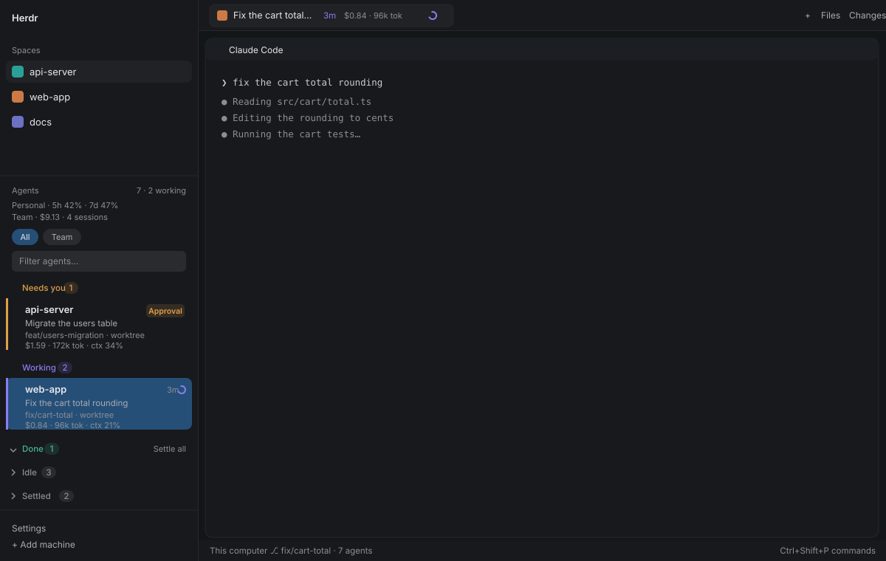

# Board V

A Herdr layout for people who run many agents: spaces on the left, and under them a vertical agent board in
folding sections (Pinned, Needs you, Working, Done, Idle, Snoozed, Settled) where each row shows the branch, cost,
tokens and time in its state. Tabs on top show how long each agent has been working and what it costs. Click a row
and its terminals fill the workspace; the keyboard can drive the whole board.

This file is the brief: enough to build Board V from an empty folder. The files that came with it are one build of
it. If they do not work on your Herdr, or you want it different, build it again from here. Read
`~/.config/herdr-app/AGENTS.md` first: it is the manual for layouts and mods.

## What you see

Two columns, left to right, filling the window (no system title bar):

1. **The sidebar**, 268px, `chrome` background, three bands:
   - The **brand bar**, 46px (`workspace-chrome`): app name, search and a collapse button.
   - The **lists**: **Spaces** (weight 1: the shipped `spaces` mod) over the **Agents board** (weight 2: the `board`
     mod in vertical mode).
   - The **footer**, 69px (`workspace-chrome`, `props.footer`): Settings and Add machine.
2. **The workspace**, the rest, three bands:
   - The **tab bar**, 42px (`tabs-stats`): tab pills with the agent's icon, title, **working time** (`3m`, in the
     `working` color, only while it works), **cost and tokens** (`$1.59 · 172k tok`, dim) and a spinner or a dot
     for the status; on the right `+`, **Files** and **Changes**.
   - The **terminal area**: the active tab's panes as cards (the layout's `main` block, `tab: "active"`), with a
     hidden 368px right panel holding Files and Changes as a stack.
   - The **status bar**, 28px (`workspace-status`).

The **Agents board** (padding 8, rows 4 apart, scrolls on its own):

- **Header** (16px sides): "Agents" and, right-aligned, `11 · 1 working` (and `· N need you` when any).
  Below, one dim 11px line **per account**: `Personal · 5h 100% · 7d 47%` for an account that reports plan
  limits, `URBN · $9.13 · 8 sessions` (spend and live sessions) for one that does not. When more than one account
  appears, rounded 22px chips: **All**, then one per account; the selected one has the `selected` background. Last,
  a 28px **search** field ("Filter agents…") on a `hover` background.
- **Section headers**, 30px, 11.5px medium: a chevron, the label in the section's color and a count pill (the
  color at 15% opacity when it has agents). **Done** and **Idle** headers also carry a right-aligned **Settle all**
  button. Sections in this order, each shown only when useful: **Pinned** (accent color; hidden when empty),
  **Needs you** (`blocked`), **Working** (`working`), **Done** (`done`: finished, not looked at yet), **Idle**
  (`idle`: seen, quiet; folded by default), **Snoozed** (dim; hidden when empty) and **Settled** (dim; hidden when
  empty, folded by default). An open empty section says "Nothing here".
- **Rows**, 8px radius, 10px padding, 9px gap, a 3px left stripe in the section's color:
  1. The program icon (14px), then the **space name** (13px semibold), then, right-aligned: a spinner while
     working, the **time in the state** (`1m`, 11px dim), for blocked rows a pill with the reason, and, when
     children exist, a chevron with their count.
  2. The agent's **title** (11.5px, `muted`), status glyphs stripped.
  3. The **branch** with a branch icon (11px), plus a `worktree` tag when the space folder is under
     `~/.herdr/worktrees`.
  4. A dim 11px line: `$1.59 · 172k tok · ctx 34%`.
  The focused agent's row uses the `selected` background; hover uses `hover`.
- **Children** of a row (live terminals it started with `hc run`, nested): 24px rows indented 24px, tree lines in
  `input`, a 12px icon, the name, a spinner or a blocked dot.

Colors come from the theme (`theme()`): stripes and labels use `blocked`, `working`, `done`, `idle` and `accent`;
text uses `foreground`, `muted`, `dim`; surfaces `chrome`, `raised`, `hover`, `selected`, `border`. Nothing is
hard-coded, so it follows light and dark.

## How it behaves

| Status | Section | Row detail |
| --- | --- | --- |
| blocked | Needs you | Pill: `Approval`, `Input`, `Failed`, else `Needs you` |
| working | Working | Spinner and time since it started working (core's `status_ms`) |
| done | Done | Time since the board first saw it finished |
| idle | Idle | Same, quiet |

- Pinned rows go to **Pinned** whatever their status. Settled agents sit in **Settled**; snoozed ones in
  **Snoozed** with `wakes 44m`. Settle and snooze only apply to finished agents. An agent that starts working
  or needs you leaves Settled and Snoozed by itself; a snooze that runs out does the same and posts a
  notification ("Snooze over").
- **Clicks:** a row focuses its agent (`pane.focus`), so its space, tab and terminals show; a section header folds;
  a children row focuses an agent or peeks a program (`terminal.peek`); an account chip filters; the clock, check
  and pin buttons that appear on hover snooze (1h), settle and pin. **Drag** a pinned row onto another to
  reorder; a 2px accent line marks the landing place. Pins, settled, snoozed, folds, the account filter and the
  last settle/pin/snooze (for undo) persist in the mod's `localStorage`.
- **Search** filters rows by space name, pane name, title, branch and program (case-insensitive). The account
  chip filters by the account that wrote the agent's session stats.
- **Keyboard** (the board must have it: bind `ctrl-shift-a` to `board.focus` under `layout:board-v` in
  `keys.json`, or press `alt-h` from the terminal): `up`/`down` or `k`/`j` and `home`/`end` move a cursor (an accent
  border); `enter`/`space` opens the agent or folds the header; `left`/`right` fold; `p` pin; `s` settle; `z` snooze
  1h, `shift+z` 4h; `u` undo; `/` search; `escape` back to the terminal. The `alt-up` / `alt-down` agent keys
  follow the board's order (`setAgentOrder`).
- The window title is `(N) Herdr` while N agents need you, else the default.
- **Tabs:** the working time counts from the core's `status_ms`; cost and tokens come from the agent's session stats.

## Built from

- **The layout** (`layouts/board-v.json`): a clone of Herdr's `main` layout. Root `row`, `titlebar: "none"`,
  `background: "canvas"`, `terminal_padding: [14, 12]`, a 1px `border` divider. Children: `sidebar` (column, 268px)
  with `brand` (block, 46px, `workspace-chrome`), `sidebar-lists` (column) holding `spaces` (block, weight 1,
  `spaces`) and `agents` (block, weight 2, `board` with `props: { vertical: true }`), and `sidebar-footer` (block,
  69px, `workspace-chrome` with `props: { footer: true }`); then `work` (column) with `tabs` (block, 42px,
  `tabs-stats`), `work-body` (row) holding `main` (block, `content: { tab: "active", pane: {…} }` with the
  shipped `pane` header mod) and `panel` (column, 368px, `hidden: true`, a `stack` `panel-body` with `files` and
  `changes` blocks), and `status` (block, 28px, `workspace-status`).
- **Shipped mods used:** `workspace-chrome`, `spaces`, `pane`, `files`, `changes`, `workspace-status`.
- **`mods/tabs-stats/`:** a clone of the shipped `tabs` mod (`mod.clone`) plus: a 15s timer that, per agent, runs
  `hc get <terminal>` (reads `foreground.pid` and `status_ms`), reads
  `<account home>/sessions/<pid>.json` (`sessionId`; the homes come from
  `~/.local/state/omarchy/agents/accounts/claude.json`, else `~/.claude`) and
  `~/.cache/claude-session-stats/<sessionId>.json`; it shows working time, cost and tokens on each tab, forces the
  Files and Changes buttons on, and shares `agent.stats` (by terminal address) and `agent.since`
  (`{ state, ms }` by address) with `setShared`.
- **`mods/board/`:** `mod.json` `{ "place": "none", "focusable": true }`. `main.js` default-exports a `View`; with
  `props().vertical` it renders the sidebar board above, otherwise three columns. Uses `agents()`, `spaces()`,
  `terminals()` (for `parent`, `state`, `status`), `shared("agent.stats")`, `shared("agent.since")`, `settings()`,
  `setAgentOrder`, `setWindowTitle`, `notify`, `nextCommand` (for `board.focus`), `localStorage`, an `InputState` +
  `Input` for the search, a focus handle with `on_key_down`, and `on_window_mouse_move` / `on_window_mouse_up` for the
  drag. Commands it runs: `pane.focus`, `terminal.peek`, `pane.go`.
- **The data file** (written by the Claude Code statusline script on each refresh, one JSON per session id):
  `{ cost, input, output, ctx, model, added, account, five, week, reset }` from the statusline input
  (`cost.total_cost_usd`, `context_window.total_input_tokens`, `total_output_tokens`, `used_percentage`,
  `rate_limits.five_hour.used_percentage`, `seven_day.used_percentage`…). Without it the board works and just
  shows no numbers.
- **Art:** only Herdr's own icons (`mods/workspace-chrome/*.svg`: chevrons, clock, check, pin, git-branch,
  spinner) and each program's icon from `program.icon`, respecting `program.tint`. No network, no programs run
  except `hc get`.

## Watch out

- Herdr's own layouts and mods are read-only: clone them (`layout.clone`, `mod.clone`), never edit them.
- A mod reads its props in `render`; `init` runs once. Never keep a `cx` and use it later, and never use
  `setTimeout`; use `cx.timer`. Animate with `svg(...).spin()`, not timers.
- The window does not reload a mod edited through a symlink: switch layout and back. Never `sed -i` a linked file.
- `workspace.panels` in the shared state may be empty, which hides the Files and Changes buttons: do not read it.
- Pin, settle and snooze are kept in the mod's storage, not on the agents; nothing is written with `hc label`.
- An account's statusline may carry no `rate_limits` (contracted Enterprise): show spend instead of 5h / 7d.
- Claude Code's built-in sub-agents are not Herdr sub-agents (those are terminals started with `hc run`).
- Not tested with real input in the build this recipe came from: the keyboard, the drag, snooze waking on time,
  the blocked reason (`status.kind` was read defensively), and a window restart for the working time.
- Working time can lag up to 15s at the start of a turn; the spend line counts only live sessions.

## Done when

- `herdr-app check` passes for `board` and `tabs-stats`, and `herdr-app status` shows no errors with the layout
  shown; switching away and back works.
- Every agent is in the right section and the counts add up to the total in the header.
- Clicking a row shows that agent's tab; a section header folds and stays folded after switching layouts.
- A tab shows `$` and tokens for a Claude Code agent, and the working time while it works.
- Pinning moves a row to Pinned; settling moves a finished agent to Settled, and starting work brings it back.
- With the keyboard on the board, `j`/`k` move the cursor, `enter` opens the agent and `escape` returns to the
  terminal.
